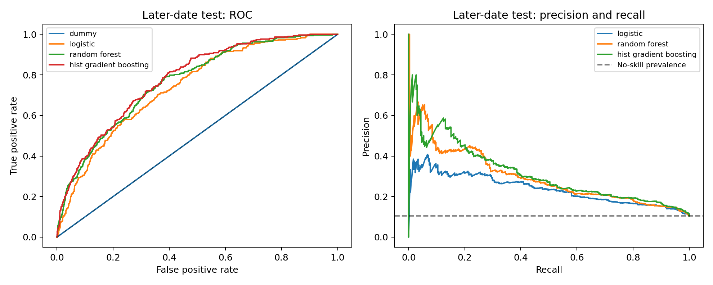

# Seattle parking occupancy classification

A Clemson Applied Data Science school project by Raphael Ugboko, Cary Dill and Hank Lin, focused on Seattle parking occupancy classification. My work spans data preparation, modeling and evaluation. This repository provides a reproducible benchmark, executed notebook, fitted models and a step-by-step study guide. Published experiment run: October 23, 2026.

## Start here

- [Executed training notebook](notebooks/Seattle_Parking_Project.ipynb)
- [Experiment implementation](experiment.py)
- [Recorded metrics and configuration](reports/benchmark.json)
- [Model card](docs/model-card.md)
- [Step-by-step study and reproduction guide](docs/reproduction-guide.md)
- [Experiment decisions and program handoff](docs/experiment-plan.md)
- [Interview talking points](docs/interview-answers.md)
- [Original group report](original-coursework/CPSC4300_6300%20Checkpoint.docx) and [slides](original-coursework/CPSC%204300%20Final%20Project.pptx)

## Question and scope

Classify whether payment-derived occupancy is at least 95% of stated blockface capacity using time, price, capacity, geography and contemporaneous weather. This is **same-time classification**, not a forecast of future space availability. The old coursework label, occupancy count at least eight, is retained only for a definition audit. The new target accounts for capacity.

The source is [arundhativt/seattle-parking-dataset](https://www.kaggle.com/datasets/arundhativt/seattle-parking-dataset), version 1, listed by Kaggle as CC0. Three shards contain 10,366,111 scanned rows. A seeded 0.5% sample leaves 47,990 valid rows after cleaning. This bounded sample covers 25 distinct observed dates between January and July 2015, with calendar gaps. It does not represent all of Seattle or a full year. Source hashes are in `reports/source-part-*.json`; the exact cleaned sample is included for reproducibility.

## Run locally

Use Python 3.12 and an isolated environment:

```bash
python -m venv .venv
# Windows: .venv/Scripts/activate
# macOS/Linux: source .venv/bin/activate
python -m pip install -r requirements-lock.txt
python experiment.py
python tools/verify_artifacts.py
```

The checked-in cleaned sample avoids a roughly 1.9 GB raw CSV download. To rebuild that sample from source, download shards and rename the existing cached sample before running `experiment.py`:

```bash
python tools/fetch_source.py --part 0
python tools/fetch_source.py --part 27
python tools/fetch_source.py --part 55
```

To execute the notebook:

```bash
python -m ipykernel install --prefix .jupyter --name seattle-parking
python tools/execute_notebook.py
```

## Evaluation contract

Train/validation/test use ordered whole dates with one date purged at each boundary. Preprocessing is fitted on training data only. Occupancy and target-derived variables are excluded from inputs. Locations may recur across partitions. Select the model on validation macro F1 at 0.5, then select its decision threshold on validation positive-class F1. Do not select either from test metrics. Three expanding-window reviews are restricted to training dates.

Published metrics include a majority baseline, accuracy, error rate, balanced accuracy, macro F1, positive precision/recall/F1, ROC AUC, average precision, log loss and confusion matrices. Saved predictions permit independent metric checks. Models include fitted preprocessing; only load joblib artifacts from sources you trust.



## Results and limitations

The validation-selected Random Forest has 100 trees, depth at most 12, and at least ten samples per leaf. Its validation-selected threshold is 0.51. On 2,852 later-date test rows it achieves ROC AUC 0.7639, average precision 0.2969, macro F1 0.6154, precision 0.2665 and recall 0.4866. Accuracy is 0.8065. A majority classifier gets 0.8955 accuracy while finding zero positive cases. This is an educational benchmark, not a production-ready parking guidance system.

Missing parking rates affect roughly 48% of sampled rows. Calibration, representative seasonal coverage, unseen-location evaluation, future-horizon forecasting and prospective user outcomes remain open. Three illustrative observed test cases are in `reports/three_cases.csv`. The benchmark JSON and executed notebook define the target, sample and evaluation settings for the published results.

## Compute and artifacts

The bounded tabular benchmark runs on CPU with two threads. No GPU is required or claimed. Saved pipelines are in `models/`. A reviewer can inspect notebook outputs, source code, configurations, predictions, timing and dependency versions without accessing Canvas. Original instructor lab notebooks and unrelated Boston housing files are excluded.
